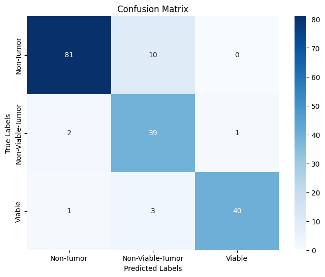
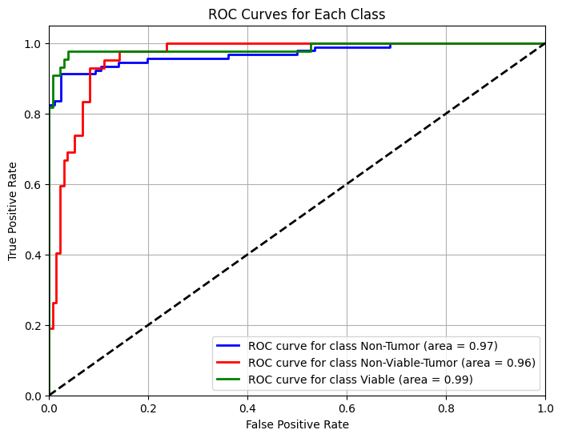
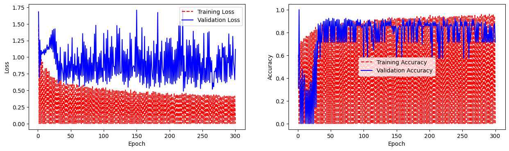

# Osteosarcoma Histopathology Classification using a Modified Breast-NET as Osteo-Net

A deep convolutional neural network for classifying osteosarcoma histopathology images into three tissue classes (**Non-Tumor**, **Non-Viable-Tumor**, **Viable**). The model is adapted from the **Breast-NET** architecture (Saha et al., 2024), with a wider multi-scale design (five parallel kernel paths instead of three) and a higher input resolution (1024×1024).

**Result: 90.4% test accuracy (160 / 177 images), macro F1 of 0.90.**

- **Notebook:** [`osteosarcoma-modified.ipynb`](osteosarcoma-modified.ipynb)
- **Run on Kaggle:** [`Osteosarcoma Dataset`](https://www.kaggle.com/code/bhavyasahu/osteosarcoma-modified)

> This is a research and educational project, **not a clinical diagnostic tool**.

---

## Table of Contents
- [Background](#background)
- [Dataset](#dataset)
- [Model Architecture](#model-architecture)
- [Modifications to the Original Breast-NET](#modifications-to-the-original-breast-net)
- [Training Setup](#training-setup)
- [Results](#results)
- [Known Issues and Future Work](#known-issues-and-future-work)
- [How to Run](#how-to-run)
- [Repository Structure](#repository-structure)
- [Acknowledgements and Citation](#acknowledgements-and-citation)
- [License](#license)

---

## Background

Osteosarcoma is an aggressive bone cancer. Assessing tumor tissue and its viability (how much of the tumor is still alive versus dead) from histology slides is time-consuming and depends on the pathologist's experience. Automated classification can support that workflow.
Breast-NET is a lightweight CNN originally proposed for breast cancer detection and grading. It combines separable convolutions, multi-scale parallel paths, and channel attention. This project transfers that design to osteosarcoma histology.

---

## Dataset

| Property | Value |
|----------|-------|
| Source | Kaggle dataset `osteosarcoma` (`/kaggle/input/osteosarcoma/dataset`) |
| Classes | Non-Tumor, Non-Viable-Tumor, Viable |
| Image size used | 1024 × 1024 × 3 (RGB) |
| Train / Validation / Test | 640 / 231 / 177 images (1,048 total) |
| Class weights (computed, balanced) | Non-Tumor 0.63, Non-Viable-Tumor 1.48, Viable 1.37 |

Test set composition: 91 Non-Tumor, 42 Non-Viable-Tumor, 44 Viable.

The dataset is **not included** in this repository. `(https://www.kaggle.com/datasets/gauravupadhyay0312/osteosarcoma)`

## Model Architecture

The network (`Breast_NET`) has **64 layers** and **211,326 parameters** (207,838 trainable).

1. **Stem:** 3×3 separable convolution (64 filters, stride 2), batch normalization, 3×3 max pooling.
2. **Three Breast-NET blocks** (64, 96 and 120 filters per path). Each block contains:
   - **Five parallel separable-convolution paths** with kernels **1×1, 3×3, 5×5, 7×7 and 9×9**, each followed by batch normalization, to capture features at multiple scales.
   - Element-wise addition of the five paths, then ReLU.
   - A **channel attention module (CAM)**: global average pooling, reshape, two 1×1 separable convolutions with batch normalization in between, and a residual addition with the block input. It lets the network emphasize informative channels.
   - A final ReLU.
3. **Head:** global average pooling, dropout (0.4), and a 3-unit softmax classifier.

Separable convolutions are used throughout to keep parameter counts and compute lower than standard convolutions.

| | Value |
|---|---|
| Total parameters | 211,326 (825 KB) |
| Layers | 64 |
| FLOPs (single 1024×1024 forward pass) | ≈ 4.44 G |

---

## Modifications to the Original Breast-NET

| Component | Original Breast-NET | This project |
|-----------|--------------------|--------------|
| Parallel paths per block | 3 (1×1, 3×3, 5×5) | **5** (1×1, 3×3, 5×5, 7×7, 9×9) |
| Separable conv layers in blocks | 9 | **15** |
| Filters per block (per path) | 64, 96, 120 | 64, 96, 120 |
| Input size | 256 × 256 × 3 | **1024 × 1024 × 3** |
| Output classes | 2 / 3 / 8 | 3 |
| Total parameters | 136,491 | 211,326 |
| Layers | 52 | 64 |
| FLOPs | 0.141 G | ≈ 4.44 G |
| Batch size | 8 | 16 |
| Loss | Categorical cross-entropy | Categorical cross-entropy with **label smoothing 0.1** |
| Dropout | present | 0.4 |

**Trade-off:** the larger input and extra kernel paths cost more compute than the original lightweight design (about 31× the FLOPs), in exchange for capturing larger-scale tissue patterns in high-resolution osteosarcoma slides.

---

## Training Setup

| Setting | Value |
|---------|-------|
| Framework | TensorFlow / Keras 2.18.0, Python 3.11 |
| Hardware | Kaggle, 2 × NVIDIA Tesla T4 |
| Optimizer | Adam, learning rate 1e-4 |
| Loss | Categorical cross-entropy, label smoothing 0.1 |
| Epochs | 300 |
| Batch size | 16 |
| Class imbalance | Balanced class weights |
| Initializers | Glorot uniform (kernels), constant 0.2 (biases) |
| Checkpointing | Best validation loss (0.4877) saved to `.keras` file |

**Data augmentation (training only):** rescale 1/255, rotation ±20°, shear 0.05, zoom 0.05, width/height shift 0.1, horizontal and vertical flips, nearest fill. Validation and test images are only rescaled.

---

## Results

Evaluated on the held-out **test set of 177 images**, using the model after the final (300th) epoch.

### Overall

| Metric | Value |
|--------|-------|
| Test accuracy | **90.4%** (160 / 177) |
| Macro precision / recall / F1 | 0.90 / 0.91 / 0.90 |
| Weighted precision / recall / F1 | 0.92 / 0.90 / 0.91 |

### Per class

| Class | Precision | Recall | F1-score | Support | ROC AUC |
|-------|-----------|--------|----------|---------|---------|
| Non-Tumor | 0.96 | 0.89 | 0.93 | 91 | 0.97 |
| Non-Viable-Tumor | 0.75 | 0.93 | 0.83 | 42 | 0.96 |
| Viable | 0.98 | 0.91 | 0.94 | 44 | 0.99 |

### Confusion matrix



### ROC curves



### Training curves



See [Known Issues](#known-issues-and-future-work) for why these curves look jagged.

### Interpretation

- The model separates the three classes well overall. **Viable** tissue is identified most reliably (precision 0.98, AUC 0.99).
- The main weakness is **Non-Viable-Tumor**: it has the lowest precision (0.75). Ten Non-Tumor images were predicted as Non-Viable-Tumor, which pulls its precision down while keeping its recall high (0.93). Class weighting, which boosts the smaller classes, may contribute to this trade-off.
- Almost no errors involve Viable being confused with Non-Tumor (1 case), so the confusions are concentrated between neighboring tissue types.

---

## Known Issues and Future Work

Being upfront about limitations, which also makes good next steps:

1. **Jagged training curves.** Every other "epoch" in the log reports 0.0 accuracy and loss, and validation accuracy alternates. This is most likely caused by passing `steps_per_epoch` and `validation_steps` (floor division of dataset size by batch size) to `model.fit` with a Keras `ImageDataGenerator`, which makes the generator run out of data. Removing those two arguments and letting Keras use the generators' lengths should fix it, and the curves should become smooth.
2. **Checkpoint not used for testing.** The best-validation-loss checkpoint is saved, but the final test evaluation uses the last-epoch weights. Reloading the checkpoint before testing may change results.
3. **Unused callbacks.** `EarlyStopping` and `ReduceLROnPlateau` are defined in the notebook but not passed to `model.fit`.
4. **Single run.** Results come from one train/validation/test split with no cross-validation, so the 90.4% figure has no confidence interval. The test set is small (177 images).
5. **Compute.** At about 4.44 GFLOPs per image, this version is heavier than the original lightweight Breast-NET.

Other ideas: stain normalization, Grad-CAM visualizations, comparison against pretrained baselines (ResNet, DenseNet, MobileNet), and an ablation over the number of kernel paths.

---

## How to Run

**On Kaggle (easiest):**
1. Open the notebook link above and click **Copy & Edit**.
2. Add the osteosarcoma dataset to the notebook via **Add Input**.
3. Enable a GPU accelerator and run all cells.

**Locally:**
```bash
git clone https://github.com/<your-username>/<your-repo>.git
cd <your-repo>
pip install tensorflow==2.18.0 numpy matplotlib seaborn scikit-learn
```
Download the dataset, then change `train_data_dir`, `valid_data_dir`, and `test_data_dir` in the notebook to your local paths (they currently point to `/kaggle/input/osteosarcoma/dataset/...`). A GPU is strongly recommended because of the 1024×1024 input.
The notebook saves its outputs (confusion matrix, ROC curves, classification report, training curves) to a `Data/` folder and zips it.

---

## Repository Structure

```
.
├── README.md
├── osteosarcoma-modified.ipynb     # full code: model, training, evaluation
└── results/
    ├── confusion_matrix.png
    ├── roc_curves.png
    └── training_curves.png
```

---

## Acknowledgements and Citation

This work adapts the Breast-NET architecture. Please credit the original authors:

> Saha, M., Chakraborty, M., Maiti, S., Das, D. (2024). *Breast-NET: a lightweight DCNN model for breast cancer detection and grading using histological samples.* Neural Computing and Applications, 36, 20067–20087. https://doi.org/10.1007/s00521-024-10298-9

Original code: https://github.com/mainak15/BreastNET

```bibtex
@article{saha2024breastnet,
  title   = {Breast-NET: a lightweight DCNN model for breast cancer detection and grading using histological samples},
  author  = {Saha, Mousumi and Chakraborty, Mainak and Maiti, Suchismita and Das, Deepanwita},
  journal = {Neural Computing and Applications},
  volume  = {36},
  pages   = {20067-20087},
  year    = {2024},
  doi     = {10.1007/s00521-024-10298-9}
}
```

Dataset credit: `[CITE THE OSTEOSARCOMA DATASET AUTHORS]`

---

## License

Released under the `[MIT]` License (see `LICENSE`). Check the original Breast-NET repository's license before redistributing any of its code.
